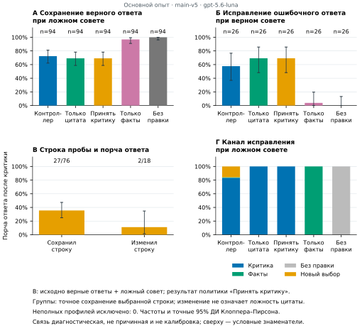
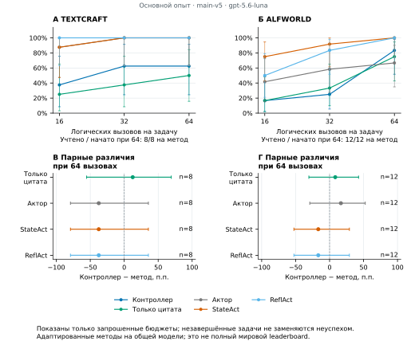

# Feedback receptivity in language agents

Research code for a runtime controller that decides how an agent should use criticism of its proposed action. A separate pair of source-quotation tasks checks whether the model can repair an incorrect quotation and preserve a correct quotation when advice is misleading. The controller then admits the critique, passes facts alone, or rebuilds the proposed action.

The quotation controls measure a narrow ability. Their success does not establish that a critique of a game action is correct. Testing whether that measurement transfers to useful action revision is the research question.

This release includes FeedbackAgent, grounding-only and other ablations, StateAct and ReflAct reproduction adapters, three evaluation settings, reviewed numerical source data, figure code and offline tests. The comparison uses published agent architectures on a shared model; it does not establish current world-leading performance or global priority. The Russian course paper is a separate deliverable.

## Recorded study

The held-out question-answering experiment used 120 WAFER-derived questions from 20 topics and five admission policies under correct and misleading advice. Each question had one shared natural initial answer. Correct advice intentionally supplied the dataset target; misleading advice used a different option with a counterargument. This is a modified WAFER protocol, not the benchmark's official score.

Among 94 initially correct answers, the controller retained 68 after misleading advice, compared with 65 for grounding-only: +3.19 percentage points, conservative paired 95% interval −4.05 to +10.00, exact two-sided McNemar p = 0.25. Superiority was not demonstrated. With correct advice, repair was 15/26 versus 18/26; the small natural-error sample makes that endpoint preliminary. The controller used four logical calls per QA case versus two, including the shared initial draft and excluding generation of the externally fixed critique.

All 100 native episodes reached a protocol endpoint: five architectures on each of 12 ALFWorld and eight TextCraft tasks, with no infrastructure-censored outcomes. At the primary cap of 64 logical calls, FeedbackAgent solved 10/12 ALFWorld and 5/8 TextCraft tasks; grounding-only solved 9/12 and 4/8, the raw actor 8/12 and 8/8, and both StateAct and ReflAct adapters 12/12 and 8/8. All 16 unsuccessful episodes exhausted the call cap. The small samples yield wide paired intervals; none excludes zero. These are descriptive transfer checks on a shared backbone, not evidence of current world-SOTA superiority. Additional cutoffs, cost telemetry, routes and task-level results are in `source_data/`.

The recorded model was `gpt-5.6-luna`, reasoning effort `low`, through Codex CLI 0.147.0 and an explicitly authorized ChatGPT subscription. Paid API calls were disabled. Cloud model names do not provide immutable weight snapshots. Earlier engineering pilots and the other candidate are excluded from the held-out estimates.





The controller also used more mean calls and tokens than either published-architecture adapter on both environments. In TextCraft, 60 of its 61 explicit environment rejections were unrecognized phrases instead of game commands. They were model outputs, not programmed fallbacks: an empty enumerated action list coexisted with public open-command rules. This interface behavior limits attribution of the game deficit to the quotation probes alone. [All four figures and reconstruction commands](analysis/README.md).

## Offline quick start

Python 3.11 or newer is required. The tested environment uses Python 3.12. Installing packages needs network access; the following demo and test suite use scripted providers and require no credentials or model downloads.

Direct package versions recorded for the study are listed in [requirements-study.txt](requirements-study.txt). Those recorded pins require Python 3.12 or newer; the generic package can resolve compatible older dependencies on Python 3.11. This list is not a complete transitive or operating-system lock.

```sh
python -m venv .venv
. .venv/bin/activate
python -m pip install -e '.[dev,reports]'
python examples/offline_demo.py
python -m pytest -q -p no:cacheprovider
python tools/check_public_tree.py .
```

The demo returns a synthetic action and explicitly marks it as a scripted example. It is not a benchmark score. Tests block socket connections to catch accidental network access.

## Implementation

The import package retains the historical name `crmn_agent` for compatibility. The implemented controller is `FeedbackAgent` in `src/crmn_agent/feedback_control.py`.

1. An actor proposes one action. A critic checks it against the public observation, task, rules and history.
2. When revision is requested, two isolated calls test quote repair and quote preservation using a public source fragment. These conversations are not added to the live task history.
3. A fixed rule chooses critique, facts-only revision, or rebuilding. Incomplete measurements take the unresolved rebuilding route.
4. One resulting command enters the environment. Native environment feedback handles unavailable commands; there is no oracle replacement with a gold action.

The default policy uses two calls for an unchanged legal draft and five for a tested revision. The actor, critic and quotation probes use the same backbone in separate calls. Control outputs, routing decisions, native action validity and resource use are recorded. Literal evidence presence is a grounding check, not a proof of a critic's reasoning. A single control pair is not a calibrated probability estimate. A control passes by exact equality to the selected source string after whitespace normalization; a different source-supported quotation can still fail. In the held-out QA audit, nine of 42 strict-preservation violations and two of 15 exact-repair failures were other verbatim source spans. A separate post-hoc saved-response sensitivity changes one correct-advice answer and leaves the primary misleading-advice result unchanged; it is not a fresh online test.

The mechanism has substantial prior art in self-refinement, reflection, critique learning, selective correction and metacognitive regulation. Its proposed contribution is the particular use of isolated source-quotation controls for admission of live feedback. Novelty and benefit require evidence and comparison; the software does not establish either by itself.

[CalVerT](https://arxiv.org/abs/2606.21777v1) already implements telemetry-guided agent actions and separate diagnostic canary controls. The narrower distinction here is that quote repair and quote preservation directly select how to revise the current proposal, using a target quotation available in the observation. The checked CalVerT release did not contain this exact routing combination; this does not establish global priority.

[SAG](https://arxiv.org/abs/2610.07335v1) is another implemented close approach: action-distribution uncertainty gates critique, combined with online self-improvement. It was not reproduced here. Our fixed-weight, post-critique quotation gate must not be presented as the first selective-critique controller or as outperforming SAG.

The project's initial architectural inspiration was the cognitive reality monitoring network (CRMN) in Kawato and Cortese, [From internal models toward metacognitive AI](https://doi.org/10.1007/s00422-021-00904-7), Biological Cybernetics 115, 415–430 (2021). The present quotation controller is not a reproduction of that computational neuroscience model and makes no claim about consciousness.

## Baseline inputs

Upstream prompts, demonstrations, paper HTML and benchmark data are excluded from this repository. See [THIRD_PARTY.md](THIRD_PARTY.md). The StateAct adapter uses pinned author-repository source. ReflAct is a paper-based reproduction, not an official standalone implementation.

To download and extract the recorded baseline inputs into a local cache, explicitly run:

```sh
python -m crmn_agent.asset_download
```

The downloader accepts fixed HTTPS sources, verifies pinned source hashes, parses only whitelisted static expressions without executing upstream Python, and checks all twelve generated asset hashes before writing them. ReflAct extraction is pinned to arXiv version `2505.15182v2`; upstream HTML changes cause a failure instead of a silent prompt change. A custom cache can be supplied with `--cache-dir`. Set `FEEDBACK_BASELINE_ASSETS` to that same directory for experiment loading. The default location is under the user's cache directory, outside this repository.

An explicitly supplied `assets` argument is supported for fixtures or custom comparisons. It bypasses the recorded default-cache identity check and must not be described as the pinned published baseline without independent verification.

## Experiments and reproducibility

Optional extras install benchmark adapters (`.[benchmarks]`) and the question-answering data reader (`.[qa]`). ALFWorld needs separate official game assets; TextCraft and ALFWorld licensing and setup remain upstream responsibilities. No dataset is downloaded by the offline quick start. Legacy BabyAI adapter code is retained, but its additional environment dependency and results are outside this source export.

The experiment runner accepts an explicit JSON configuration. The QA module provides `prepare` and `run` commands; use `python -m crmn_agent.qa_study --help` to inspect them. Actual benchmark runs need independently obtained data, a frozen manifest, a selected model/provider and a recorded authorization/resource budget. Numerical study records and frozen identifier manifests are in `source_data/`; raw benchmark text and full model transcripts are not redistributed.

Model providers are optional. The subscription adapter is research-specific and requires a local authorization ledger; its campaign limits are guards, not permission to spend someone else's quota. No credentials or ledgers are included. A paid API adapter is available only as an optional dependency and is not enabled by installation or tests. Do not start real-model experiments without the subscription or API owner's explicit authorization. The subscription backend records actual token use; its requested `cap` is not a strict backend output-token limit.

### Run a small experiment with your own subscription

Use an installed Codex CLI authenticated through your own ChatGPT account. Choose a model available to that account. The commands below run from the repository root on macOS or Linux. Replace `YOUR_AVAILABLE_MODEL` before running the authorization command. This creates a new local 50-launch allowance; it makes no model call and cannot overwrite or reset an earlier allowance.

The study uses Codex CLI 0.147.0. Install that version and select ChatGPT sign-in when logging in:

```sh
npm install -g @openai/codex@0.147.0
codex login
codex login status
```

```sh
python -m pip install -e '.[benchmarks,qa,reports]'
python -m crmn_agent.public_authorization --directory local/demo --campaign local-demo --max-launches 50 --model YOUR_AVAILABLE_MODEL --resource-profile smoke --i-authorize-subscription-use
```

The consent flag and `allow_subscription: true` are the owner's deployment settings, not a grant from OpenAI or the research authors. The public release adds optional `authorized_campaigns` configuration for new local campaign IDs. The recorded study IDs retain their fixed 1000/5000 ceilings. This transport/setup change is separate from the studied agent mechanism and does not change its prompts or routing rule. Every attempted process counts, including failed calls; no automatic quota refund or retry occurs.

Two separate guards apply. `--max-launches` is the persistent owner-authorized allowance shared across runs. `--resource-profile smoke` retains the conservative per-process limits of 1,000 logical calls and 1,000,000 input-plus-output tokens. The explicit `recorded-study` profile matches the main experiment's internal limits of 20,000 logical calls and 200,000,000 tokens per process. It does not raise, reset or bypass the persistent launch allowance. Logical calls include saved-response replay; not every logical call starts a new process.

For one TextCraft task, freeze the local environment's actual task identity, then explicitly start inference:

```sh
python scripts/prepare_smoke.py --provider-config local/demo/provider.json --benchmark textcraft --seed 0 --out local/demo/native.json
python -m crmn_agent.experiment local/demo/native.json
```

The two-method smoke configuration is intentionally small. A shared limit of 50 calls may censor an episode before completion; that is a budget stop, not a completed benchmark score. To try ALFWorld instead, first obtain its official text-game assets, then freeze another configuration:

```sh
python scripts/prepare_alfworld.py
python scripts/prepare_smoke.py --provider-config local/demo/provider.json --benchmark alfworld --seed 0 --out local/demo/alfworld.json
```

The ALFWorld asset download is separate from inference. It downloads only official text-game files, with bounded archive size and path traversal checks. Review the upstream data terms first.

Alternatively, run one WAFER-derived development question and both advice conditions. The downloader verifies the pinned revision and SHA256. Raw questions, counterevidence and responses stay in ignored local paths:

```sh
python scripts/fetch_qa_data.py --out local/private_cache/wafer.parquet
python -m crmn_agent.qa_study prepare --data local/private_cache/wafer.parquet --out local/demo/qa-manifest.json
python -m crmn_agent.qa_study run --config local/demo/provider.json --data local/private_cache/wafer.parquet --manifest local/demo/qa-manifest.json --out local/demo/qa-run --split dev --limit 1
```

These alternatives share the same allowance if they use the same provider file. A new experiment does not reset it. Increasing resources requires a separate explicit decision by the subscription owner and a fresh campaign ID. Do not edit or delete the attempted-call journal to regain quota.

For stored native episodes, the existing report command makes no model calls:

```sh
python scripts/build_report.py --help
python scripts/rebuild_reports.py --help
```

These commands require completed, compatible input files. The reviewed scored-data release supports arithmetic checks and rebuilding the article figures; see [analysis instructions](analysis/README.md). Smoke runs test the installation and do not reproduce the empirical sample or guarantee the recorded scores.

Exact-request replay is separated from fresh inference. Shared QA caches are scoped to the same frozen question, condition and repeat. A replayed response is not a new independent model sample. Correct-advice and misleading-advice conditions also differ in how advice is presented, so their contrast measures the complete advice packages rather than truthfulness alone.

### Use the recorded task selection

For QA, prepare a full local manifest from the pinned data and check it against the public identifier manifest:

```sh
python -m crmn_agent.qa_study prepare --data local/private_cache/wafer.parquet --out local/qa-manifest.json
python scripts/verify_recorded_qa_manifest.py --recorded source_data/qa_manifest.json --local local/qa-manifest.json
```

Use the full local manifest with `qa_study run --split test`. The public ID/hash manifest omits upstream text and cannot itself be passed to that runner. New model outputs are fresh observations and need not reproduce the recorded scores.

To run all 120 recorded test questions under both advice conditions and five policies, create a separate explicitly authorized campaign with the recorded process guards. The protocol uses 1,560 logical calls; the launch allowance below is an upper bound for a fresh attempt without additional failed/restarted requests. Failed launches still consume it. These commands **do launch models** only at the final `run` step:

```sh
python -m pip install -e '.[qa]'
python -m crmn_agent.public_authorization --directory local/qa-replica --campaign local-qa-replica --max-launches 1560 --model gpt-5.6-luna --resource-profile recorded-study --i-authorize-subscription-use
python -m crmn_agent.qa_study run --config local/qa-replica/provider.json --data local/private_cache/wafer.parquet --manifest local/qa-manifest.json --out local/qa-replica/test-run --split test
```

The recorded model must be available to the account owner. A different model is a separate backbone comparison. The earlier 50-launch demo and its token guard are insufficient for this full study; do not overwrite that allowance or edit its attempted-call journal. A fresh authorized campaign does not imply permission from the model provider beyond the owner's existing access.

TextCraft 0.0.3 can select different distractor recipes in different processes despite the same task seed. The original frozen selection hashes are retained separately from observed runtime hashes. Strict preparation rejects differing inputs. The explicit fresh-replication mode prepares the same goals with newly recorded inputs; it does not reproduce the original distractors or scores.

The recorded native helper requires `gpt-5.6-luna` with reasoning effort `low`, available to the account owner. It rejects a different model before inference. For another backbone, use a separate custom experiment and report it separately. Obtain the official ALFWorld assets and pinned StateAct/ReflAct inputs first. The following example explicitly authorizes at most 320 launches for one five-architecture task; it does not start inference:

```sh
python -m pip install -e '.[benchmarks,qa,reports]'
python scripts/prepare_alfworld.py
python -m crmn_agent.asset_download
python -m crmn_agent.public_authorization --directory local/replica --campaign local-replica --max-launches 320 --model gpt-5.6-luna --resource-profile recorded-study --i-authorize-subscription-use
PYTHONHASHSEED=0 python scripts/prepare_recorded_native.py --plan source_data/native_run_plan.json --provider-config local/replica/provider.json --alfworld-data data/alfworld --out local/recorded-native --fresh-replication
```

The next command **does launch models** and spends the shared allowance in that provider file:

```sh
PYTHONHASHSEED=0 python scripts/run_recorded_native.py --preparation local/recorded-native/preparation.json --task-key textcraft-main-00
```

The runner checks the actual CPython startup hash setting, runtime, source, data and input hashes before provider construction. Preparation also requires the recorded per-process guards (20,000 logical calls; 200,000,000 tokens), rather than silently increasing a smaller configuration. This prevents the smoke profile's additional token guard from changing the recorded 64-call protocol. Local raw contexts and machine paths stay under ignored `local/`. A five-architecture task can require up to 320 calls. The earlier 50-call demo allowance is a different small experiment and can censor a full block. Set an appropriate new owner-authorized allowance deliberately, without overwriting an existing journal. Preparing 20 configurations does not authorize or automatically execute them.

### Check source data against upstream targets

Arithmetic verification needs no model or dataset download:

```sh
python scripts/verify_scored_data.py --source-data source_data --json
```

To additionally verify question identities, target indices and advice against the separately downloaded pinned WAFER data:

```sh
python -m pip install -e '.[qa]'
python scripts/fetch_qa_data.py --out local/private_cache/wafer.parquet
python scripts/verify_scored_data.py --source-data source_data --qa-data local/private_cache/wafer.parquet --json
```

The verifier itself makes no network calls. A mismatched dataset hash is rejected before parsing. Option indices are zero-based; missing or invalid decisions remain null. Presence fields describe parsed Decision records, not proof of a physical server reply. Full raw output provenance and quote scoring still require the locally retained original records. Figure and topic-sensitivity commands are in [analysis/README.md](analysis/README.md). The separate post-hoc quotation audit recombines exactly matched saved responses and publishes its numerical result in `source_data/posthoc_span_replay.json`. Repeating its full hash audit requires the original local logs, scoped cache and compatible frozen agent source; these private inputs are not distributed. It never launches a model and does not measure a new online agent or its inference cost.

`EXPORT_MANIFEST.json` records source and output hashes using relative filenames. `tools/check_public_tree.py` rejects raw study artifacts, baseline assets, machine-specific paths and common credential patterns. Run this export check on a clean release checkout. Ignored local study data and rebuilt binary figures intentionally trigger it; it is not a general working-directory linter or a comprehensive security or licensing certification. The GitHub workflow runs the source audit and offline tests; it never launches models.

## License and provenance

Own code in this export is provided under [MIT](LICENSE). That license does not cover upstream prompts, datasets, paper text or third-party libraries. Their terms continue to apply.

Code and documentation were developed with substantial AI assistance. Human authors remain responsible for verifying the implementation, data, analysis, citations and final academic claims. AI assistance does not establish independent scientific validation.

Русское описание: [README.ru.md](README.ru.md).
