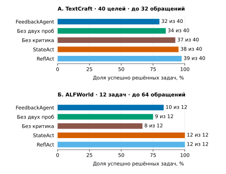
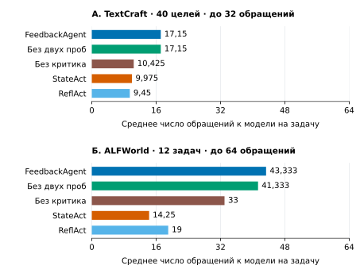

# FeedbackAgent

[Как установить и запустить](docs/RUNNING_RU.md) · [Данные и рисунки](analysis/README.md) · [English overview](README.md)

FeedbackAgent решает, как использовать совет при выборе игрового действия или ответа на вопрос. В первой попытке модель предлагает действие. В отдельном обращении та же модель выступает критиком. Она читает задачу и сообщает, что стоит исправить.

Если критик просит изменить действие, программа даёт модели две короткие задачи на цитаты. Например, игра сообщила: «Коробка закрыта». Этот видимый модели текст и есть источник.

- **Проверка исправления.** Модель получает источник, неверную цитату «Коробка открыта» и совет исправить её. Ожидаемый ответ — «Коробка закрыта».
- **Проверка сохранения.** Модель получает тот же источник, верную цитату «Коробка закрыта» и ошибочный совет заменить её. Ожидаемый ответ — оставить цитату как есть.

Программа сопоставляет ответы с источником. По результатам она выбирает, показать модели замечание, передать только проверяемые факты или попросить предложить новое действие. Цитата «Коробка закрыта» подтверждает состояние коробки. Она сама по себе ничего не говорит о том, нужно ли её открывать для выполнения задачи. Поэтому умение сверять цитаты может слабо помогать при выборе полезного совета.

[Схема двух проверок цитат](figures/coursework/quote-checks.svg) · [Код FeedbackAgent](src/crmn_agent/feedback_control.py)

## Результаты

**Вопросы с источником.** В опыте использовали 120 вопросов на основе WAFER. При ошибочном совете FeedbackAgent сохранил 68 из 94 исходно верных ответов. Вариант с одной проверкой цитаты сохранил 65 из 94. Разница составила 3,19 процентного пункта. 95%-й интервал от −4,05 до +10,00 п. п. включает ноль, точный парный тест дал p = 0,25. При верном совете варианты исправили 15 и 18 из 26 ошибок соответственно. Польза двух дополнительных проверок не подтверждена. [Диаграмма для вопросов](figures/coursework/qa-results.svg)

**Игровые задачи.** Все варианты проходили одинаковые задачи внутри каждой среды. В TextCraft они также получали одинаковое пояснение игровых команд.

| Вариант | Как он выбирает действие | TextCraft, до 32 вызовов | ALFWorld, до 64 вызовов |
| --- | --- | ---: | ---: |
| FeedbackAgent | Критик, проверка его цитаты и две задачи на цитаты | 32/40 | 10/12 |
| Без двух проб | Критик и проверка его цитаты | 34/40 | 9/12 |
| Без критика | Модель сразу выбирает действие | 37/40 | 8/12 |
| StateAct | Модель кратко описывает текущее состояние игры и выбирает действие | 38/40 | 12/12 |
| ReflAct | Модель оценивает, что уже сделано и что осталось до цели, затем выбирает действие | 39/40 | 12/12 |

В TextCraft сравнение охватывает 200 эпизодов и 2566 обращений к модели. Эпизод — одна попытка одного варианта решить задачу. В ALFWorld было 60 эпизодов и 1811 запусков модели. Реализации StateAct и ReflAct решили больше задач и в среднем использовали меньше обращений, чем FeedbackAgent. Парные сравнения с FeedbackAgent в TextCraft дали p = 0,09375 и p = 0,0625 после поправки на четыре сравнения. Эти данные оставляют статистическую неопределённость.

Во всех сериях использовали модель `gpt-5.6-luna`, уровень рассуждения `low` и Codex CLI 0.147.0. Обращения шли по разрешённой подписке ChatGPT. Платный API не использовали. Серии TextCraft прошли в разное время. Одно имя облачной модели не гарантирует, что её версия оставалась неизменной.

## Запуск и проверка

Сначала откройте [пошаговую инструкцию](docs/RUNNING_RU.md). Там есть команды для Windows PowerShell, Linux, macOS и WSL2. Учебный пример и проверка сохранённых чисел работают без модели.

- [TextCraft: пять вариантов на 40 целях](retests/textcraft_baselines/README_RU.md). Здесь находятся числовые данные и инструкции для проверки и отдельной репликации StateAct и ReflAct.
- [TextCraft: три варианта с тем же пояснением команд](retests/textcraft/README_RU.md). Их код и команды репликации находятся в отдельном пакете. Этот пакет включает дополнительный контрольный вариант без пояснения команд.
- [Вопросы WAFER и задачи ALFWorld](README.md#use-the-recorded-task-selection). Исходные команды сохранены вместе с описанием отбора задач.

Новые обращения к модели требуют отдельного разрешения владельца подписки и поддерживаемой среды Linux, macOS или WSL2. Закрытые журналы служат только для истории.

## Что относится к вкладу работы

Идея работы — применить две отдельные проверки цитат для выбора способа пересмотра предложенного действия. В CalVerT уже применяют отдельные диагностические задания для управления агентом. В SAG решение о применении критики зависит от неопределённости при выборе действия. CRMN в работе Кавато и Кортезе послужила исходным ориентиром. Сравнение проверяет конкретные варианты на общей модели и не устанавливает мировой приоритет. [CalVerT](https://arxiv.org/abs/2606.21777v1) · [SAG](https://arxiv.org/abs/2610.07335v1) · [CRMN](https://doi.org/10.1007/s00422-021-00904-7)

Код и документацию подготовили с существенной помощью ИИ. Ответственность за проверку материалов и выводов остаётся за авторами. [Лицензия MIT](LICENSE) · [Условия использования сторонних материалов](THIRD_PARTY.md)
