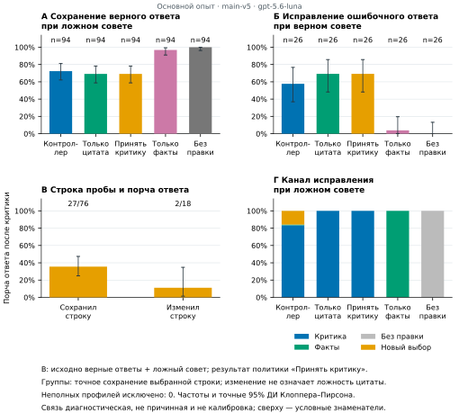
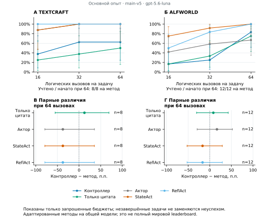

# Контроль восприимчивости агента к обратной связи

Репозиторий содержит исследовательскую реализацию FeedbackAgent. Агент предлагает действие, получает замечание критика и решает, каким способом его учитывать. Для этого два отдельных обращения к модели проверяют, исправляет ли она неверную цитату и сохраняет ли верную цитату вопреки ошибочному совету. Источником служит только доступное агенту наблюдение.

После проверки контроллер выбирает один из путей: использовать замечание, передать только факты или построить действие заново. Исполнитель, критик и пробы используют одну модель в отдельных обращениях. Результаты контрольных заданий не попадают в игровую историю. За один шаг агент исполняет одну команду; неправильные команды обрабатывает сама среда.

Проверка цитат измеряет узкую способность. Она сама по себе не доказывает, что критик правильно оценил игровое действие. Пробы оцениваются по точному совпадению с выбранной строкой после нормализации пробелов: иной поддержанный источником фрагмент тоже может не пройти проверку. В QA девять из 42 нарушений строгого сохранения и два из 15 неудачных точных восстановлений являются другими дословными фрагментами источника. Отдельная постфактум-перекомбинация сохранённых ответов меняет один ответ при верном совете и не меняет основное сравнение после ошибочного совета; это не новый онлайн-прогон. Главный исследовательский вопрос состоит в том, помогает ли такая проверка выбирать полезный способ исправления действий.

## Результат основного теста

В контролируемом эксперименте проверены 120 вопросов WAFER из 20 тем, пять политик и два вида совета. Первоначальный ответ общий для политик. Правильный совет намеренно сообщает эталонную букву; ошибочный содержит другую букву и контрдовод. Это адаптированный протокол, а не исходный балл WAFER.

После ошибочного совета контроллер сохранил 68 из 94 исходно правильных ответов, grounding-only, проверяющий только наличие цитаты, — 65 из 94. Разность +3,19 п.п., консервативный парный 95% интервал от −4,05 до +10,00, точный двусторонний тест Мак-Немара p = 0,25. Превосходство не подтверждено. При правильном совете исправлено 15/26 ошибок против 18/26; этот показатель предварительный из-за малого числа естественных ошибок. В QA контроллер требует четыре логических вызова против двух, включая общий черновик; отдельная генерация заданного критика здесь не выполняется.

Завершены все 100 игровых эпизодов: по пять вариантов на 12 задачах ALFWorld и 8 TextCraft, без инфраструктурно цензурированных исходов. При 64 логических вызовах FeedbackAgent решил 10/12 и 5/8 задач, grounding-only — 9/12 и 4/8, исполнитель без критика — 8/12 и 8/8, адаптации StateAct и ReflAct — по 12/12 и 8/8. Все 16 неуспешных эпизодов остановились по лимиту обращений. Парные интервалы широки и включают нуль. Это описательная проверка переноса на общей модели; превосходство над актуальным мировым SOTA не установлено. Дополнительные срезы 16/32, затраты, каналы и результаты отдельных задач опубликованы в `source_data/`.

Использована модель `gpt-5.6-luna` с уровнем рассуждения `low` через Codex CLI 0.147.0 по явно разрешённой подписке ChatGPT. Платный API отключён. Ранние инженерные пилоты и другой прототип не объединяются с итоговыми оценками.





Средние затраты контроллера по обращениям и токенам выше, чем у обоих адаптеров опубликованных архитектур на каждой среде. В TextCraft 60 из 61 явного отказа среды связаны с нераспознаваемыми фразами вместо игровых команд. Это ответы модели, а не запрограммированная заглушка: при пустом списке перечисленных действий публичные правила задают открытые команды. Такая интерпретация интерфейса ограничивает вывод о чистом эффекте проб. [Все четыре рисунка и команды их построения](analysis/README.md).

## Быстрый запуск без моделей

Нужен Python 3.11 или новее. Загрузка зависимостей требует сети, но демонстрация и тесты используют подготовленные ответы и не обращаются к моделям.

```sh
python -m venv .venv
. .venv/bin/activate
python -m pip install -e '.[dev,reports]'
python examples/offline_demo.py
python -m pytest -q -p no:cacheprovider
python tools/check_public_tree.py .
```

Демонстрация явно помечена как синтетическая и не является результатом на бенчмарке. Тесты блокируют сетевые соединения. Пакет сохранил техническое имя `crmn_agent`; основной механизм находится в `src/crmn_agent/feedback_control.py`.

## Что входит в пакет

Включены агент, абляции, адаптеры TextCraft и ALFWorld, воспроизведения StateAct и ReflAct, протокол испытания на фиксированных вопросах, анализ и модульные тесты. Проверенные числовые данные и идентификаторы задач находятся в `source_data/`, код рисунков в `analysis/`. Курсовая статья подготовлена отдельным файлом. Сравнение опубликованных архитектур на общей модели не подтверждает мировой приоритет или положение в актуальной таблице SOTA.

Механизм опирается на исследования самокоррекции, рефлексии, обучения на критике и избирательного принятия исправлений. Предполагаемый вклад относится к конкретному способу использования отдельных проверок цитат для допуска обратной связи. Его пользу и границы необходимо подтвердить экспериментами.

Близкая работа [CalVerT](https://arxiv.org/abs/2606.21777v1) уже реализует управление действиями по телеметрии и отдельные диагностические canary-контроли. Здесь более узкое отличие: исправление неверной и сохранение верной цитаты непосредственно выбирают способ пересмотра текущего предложения. Целевой текст доступен в наблюдении. В проверенном релизе CalVerT такая связка не найдена; мировой приоритет этим не установлен.

В [SAG](https://arxiv.org/abs/2610.07335v1) уже реализованы допуск критики по неопределённости распределения действий и последовательное самообучение. Здесь SAG не воспроизводился. Наш вариант выбирает канал после получения критики и использует неизменные веса; его нельзя объявлять первым избирательным контроллером критики или превосходящим SAG.

Исходным архитектурным ориентиром проекта была cognitive reality monitoring network (CRMN) из статьи Kawato и Cortese [From internal models toward metacognitive AI](https://doi.org/10.1007/s00422-021-00904-7), Biological Cybernetics 115, 415–430 (2021). Текущий контроллер цитат не воспроизводит эту вычислительную модель и не проверяет наличие сознания.

## Входные материалы бейзлайнов

Чужие промпты, примеры, HTML статей и данные не включены. Для явной загрузки фиксированных входов StateAct и ReflAct выполните:

```sh
python -m crmn_agent.asset_download
```

Загрузчик проверяет хеши исходников и всех двенадцати извлечённых файлов. Чужой Python не исполняется. StateAct привязан к фиксированному коммиту авторского репозитория, ReflAct воспроизводится по конкретной версии статьи. Изменение исходного HTML приводит к ошибке проверки. Кеш хранится вне репозитория; путь можно задать через `--cache-dir` и `FEEDBACK_BASELINE_ASSETS`.

Явно переданный нестандартный каталог `assets` допустим для тестов, но без отдельной проверки не считается зафиксированным опубликованным бейзлайном. Условия использования чужих материалов описаны в [THIRD_PARTY.md](THIRD_PARTY.md).

## Реальные эксперименты

Для реальных прогонов нужны отдельно полученные данные, фиксированный набор задач, конфигурация модели и разрешение владельца подписки или API на расход ресурсов. Опциональные зависимости `.[benchmarks]` и `.[qa]` добавляют адаптеры сред и чтение данных. Игровые данные ALFWorld загружаются отдельно по официальной инструкции. Старый адаптер BabyAI сохранён в коде, но его дополнительные зависимости и результаты не входят в эту сборку.

Локальные ключи, авторизации, журналы и сырые ответы не публикуются. Установка и тесты не включают платный API. Адаптер подписки учитывает реальные токены; параметр `cap` не является строгим ограничением выходных токенов в этом бэкенде.

Конкретные команды настройки нового лимита в 50 запусков, запуска TextCraft, загрузки ALFWorld и фиксированной версии WAFER приведены в разделе [Run a small experiment with your own subscription](README.md#run-a-small-experiment-with-your-own-subscription). Нужно указать модель, доступную вашей учётной записи Codex, и явно подтвердить расход собственной подписки. Создание авторизации не запускает модель; следующий запуск эксперимента расходует общий лимит, включая неудачные попытки. Повтор команды или новая задача не обнуляют журнал.

Переносимая настройка `authorized_campaigns` добавлена только в публичную транспортную обёртку. Она не меняет промпты и алгоритм агента, а прежние лимиты исследовательских кампаний остаются фиксированными. Малый smoke-прогон проверяет работоспособность; он не воспроизводит выборку и результаты статьи. Пересчёт показателей и построение графиков выполняются по опубликованным числовым данным; команды приведены в [analysis/README.md](analysis/README.md).

Постоянный лимит `--max-launches` и внутренние ограничения процесса задаются отдельно. Профиль `--resource-profile smoke` сохраняет 1000 логических вызовов и 1 млн входных и выходных токенов на процесс. Явный `--resource-profile recorded-study` задаёт внутренние пределы основного эксперимента: 20 000 логических вызовов и 200 млн токенов. Он не увеличивает и не обнуляет разрешённое число запусков. Повтор сохранённого ответа тоже считается логическим вызовом, но не новым запуском модели.

Повтор ответа из кеша отделяется от нового обращения к модели. Общий QA-кеш применяется только к одному фиксированному вопросу, условию и повтору; такой ответ не считается новой независимой выборкой. Условия полезного и вредного совета отличаются также формой его предъявления, поэтому сравнивается весь пакет совета, а не только его истинность.

## Проверка опубликованных результатов

Эта команда пересчитывает показатели и парные сравнения без модели, подписки и загрузки датасета:

```sh
python scripts/verify_scored_data.py --source-data source_data --json
```

Для дополнительной сверки с исходными эталонами нужно отдельно скачать закреплённый WAFER:

```sh
python -m pip install -e '.[qa]'
python scripts/fetch_qa_data.py --out local/private_cache/wafer.parquet
python scripts/verify_scored_data.py --source-data source_data --qa-data local/private_cache/wafer.parquet --json
```

Сам верификатор в сеть не обращается. Он проверяет хеш файла, идентификаторы вопросов, числовые индексы эталонов и пересчитанную правильность. Нумерация вариантов начинается с нуля; отсутствующий или некорректный вариант сохраняется как null. Признак присутствия означает сохранённый разобранный объект Decision, а не доказательство физического ответа сервера. Полные модельные ответы и цитаты проб остаются локальными. Числа отдельного постфактум-перерасчёта доступны в `source_data/posthoc_span_replay.json`. Полная повторная сверка его хешей требует исходных журналов, scoped cache и совместимого замороженного agent-src; эти приватные входы не распространяются. Скрипт не запускает модель и не измеряет работу нового онлайн-агента.

Построение четырёх рисунков и анализ чувствительности по темам описаны в [analysis/README.md](analysis/README.md). Версии основных библиотек приведены в [requirements-study.txt](requirements-study.txt); эти конкретные версии требуют Python 3.12 или новее. Это список прямых зависимостей, а не полный снимок окружения; общая установка на Python 3.11 может выбрать совместимые более старые версии.

## Новая репликация на тех же целях

Команды подготовки и запуска приведены в [Use the recorded task selection](README.md#use-the-recorded-task-selection). Этот помощник требует доступный владельцу `gpt-5.6-luna` с уровнем `low`; другую модель нужно испытывать отдельно. Для пяти архитектур предварительно загружаются входы StateAct/ReflAct командой `python -m crmn_agent.asset_download`. Публичный QA-манифест содержит только ID и хеши: для нового прогона полный локальный манифест строится из отдельно скачанного файла и сверяется скриптом `verify_recorded_qa_manifest.py`.

В этом же разделе есть команда полного QA-прогона: 120 вопросов, два условия совета и пять политик используют 1560 логических вызовов. Для него явно выбирается профиль `recorded-study` и создаётся отдельное разрешение на 1560 запусков. Неудачные попытки тоже расходуют разрешение, поэтому оно не гарантирует завершение при дополнительных сбоях или перезапусках. Малый лимит в 50 запусков и его токенный предел для полного теста недостаточны. Подготовка Native отвергает несовпадающие внутренние пределы до создания среды и провайдера, вместо их молчаливого повышения.

В TextCraft одинаковый seed сохраняет цель, но между процессами может менять отвлекающие рецепты. Исходные хеши отбора и хеши фактических входов опубликованы отдельно. Строгий режим подготовки останавливается при несовпадении. Явный `--fresh-replication` фиксирует новые входы для тех же целей и не обещает исходных рецептов или оценок. Подготовка не вызывает модели; `run_recorded_native.py` расходует отдельно разрешённый общий лимит. Для обоих запусков нужен `PYTHONHASHSEED=0` с момента старта Python. Перед созданием провайдера проверяются среда, файлы и входные условия.

Один блок из пяти архитектур может потребовать до 320 вызовов. Предыдущий демонстрационный лимит в 50 вызовов способен прервать его до завершения; новый лимит задаётся отдельным осознанным разрешением владельца подписки без перезаписи прежнего журнала. Создание двадцати конфигураций само по себе не запускает эксперименты. Сырые локальные контексты, конфигурации и пути не коммитятся.

Файл `EXPORT_MANIFEST.json` содержит относительные пути и хеши сборки. Проверка `tools/check_public_tree.py` ищет случайно попавшие закрытые материалы, чужие входные файлы и распространённые шаблоны секретов. Это проверка чистой публикуемой сборки: локальные данные и заново построенные бинарные рисунки намеренно вызывают её отказ, даже если игнорируются Git. Она не заменяет полного аудита безопасности и лицензий.

Собственный код распространяется по [MIT](LICENSE). Эта лицензия не распространяется на чужие данные, промпты и статьи. Код и документация подготовлены с существенной помощью ИИ; проверка реализации, данных, анализа и научных утверждений остаётся ответственностью авторов.
